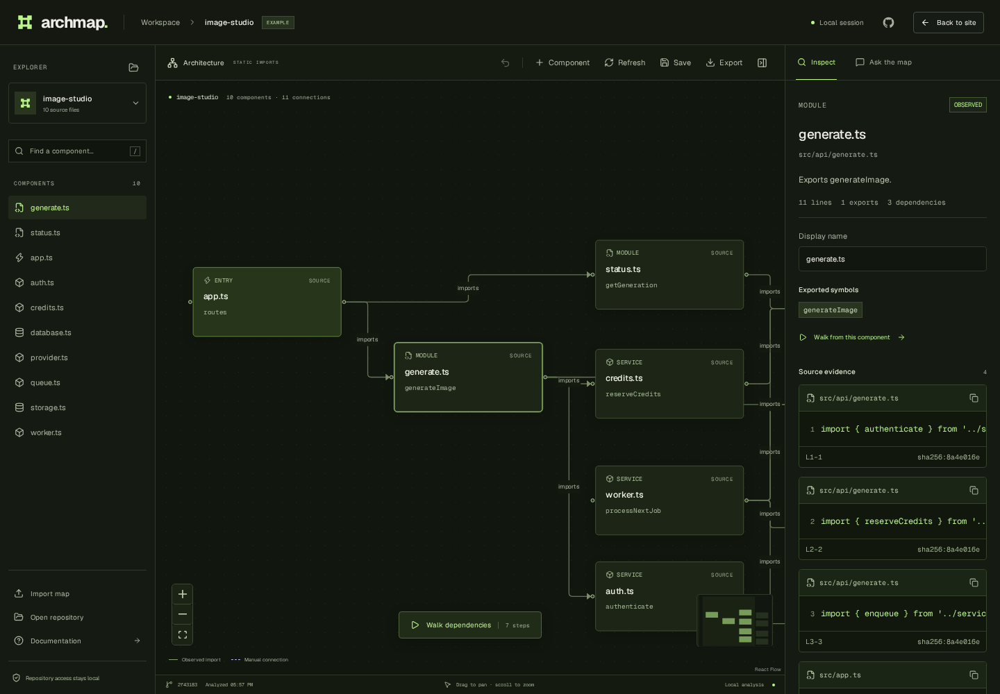

<div align="center">

# ArchMap

### Understand the feature. Inspect the evidence. Shape the map.

Local-first architecture exploration, guided source walkthroughs, and reviewable model proposals.

[Getting started](#getting-started) · [What it does](#what-it-does) · [How-it-works](#how-it-works) · [Contributing](CONTRIBUTING.md)

</div>



ArchMap is an open-source web app for understanding JavaScript and TypeScript projects. Start with a responsibility overview, follow a named feature flow, inspect supporting source, and ask for a proposed map you can review before applying.

**This is an early architecture workbench, not a runtime tracer.** Structural boundaries are inferred from source organization. Call-site walkthroughs follow lexical source order. Model-generated responsibilities and relationships remain interpretations, even when their source references validate.

## Getting started

Requires **Node.js 22.12+** and Git. A model is optional.

```bash
git clone https://github.com/ICEQ-JO/ArchMap.git
cd ArchMap
npm install
npm run dev
```

Keep that terminal running and open **http://localhost:4310**. The included Image Studio example has architecture areas and named Generate Image, Process Next Job, and Get Generation flows. Its illustrative source is in `examples/image-studio`; it is not a deployed image-generation service.

Repository access is restricted to the startup directory and its descendants. To explore sibling projects:

```bash
ARCHMAP_ROOT=/absolute/path/to/projects npm run dev
```

You can save `ARCHMAP_ROOT` in an ignored local `.env` file. Restart after changing it. Enter an absolute folder inside that root, or a path relative to it. On Windows PowerShell, use `$env:ARCHMAP_ROOT = 'C:\projects'` before running `npm run dev`.

Use **Feature focus** to prioritize matching paths before the scan limit, or choose a smaller source folder. Focus is a filename/path hint, not a semantic search across an entire unscanned repository. Partial analyses are explicitly labeled.

## What it does

- **Architecture overview:** group source into responsibility areas such as API handlers, identity, workers, messaging, storage, and UI. Boundaries are labeled inferred; inspect their member files.
- **Architecture change review:** compare a local Git revision with the working tree; inspect changed responsibility areas, files, static dependencies, and before/after source. The review preserves your editable map.
- **Source detail view:** switch to individual modules and their observed imports without losing the other view.
- **Named guided flows:** resolve calls to named imported symbols in top-level functions, step through their lexical order, and inspect the exact call site. Parameter/local shadowing and nested callbacks are excluded; branches and loops are flagged. This is conservative syntax analysis, not whole-program call resolution or a runtime trace.
- **Reviewable feature maps:** ask a configured model for a feature architecture, inspect proposed responsibilities and relationship evidence, then apply or discard. Undo restores the previous view. Applying deliberately replaces the active view; the original source graph is retained.
- **Useful without a model:** source-based proposals focus matching responsibilities and immediate dependencies; local explanations search evidence. These modes are labeled and do not pretend to be AI reasoning.
- **Sketch first:** start a blank map, add components, describe responsibilities, connect them, and save it without a repository connection.
- **Own the result:** move and rename components, edit descriptions, add manual connections, undo changes, save locally, and import/export readable project JSON.

## Review a coding change

Open a local repository, select **Changes** in the workspace toolbar, choose a baseline (`HEAD`, a local branch, tag, or commit), then select **Compare changes**. Focus the review with a feature question, symbol, or path; read a source-cited change brief and select an affected responsibility to inspect before/after evidence. `HEAD` includes staged, unstaged, and untracked source changes.

This review uses no model and makes no checkout or source edits. It covers inspected JS/TS source, not a complete application or runtime trace. When coverage is incomplete, addition/removal and dependency-change claims are withheld. Source excerpts show the first changed area, not a full patch. See [change review and its limits](docs/change-review.md).

## Follow OpenCode tasks

Start OpenCode in your repository with `opencode --port 4096 --hostname 127.0.0.1`. In ArchMap, open the repository and select **OpenCode sessions** (the cable icon in the inspector). Connect, choose an idle session, and select **Track next task** before submitting your task in OpenCode.

ArchMap captures your current source, including existing uncommitted work. Keep the panel open; a source-backed change review opens after observed activity returns to idle. The adapter sends no prompts or code to OpenCode and runs no tools. Reviews cover all changes since capture, including edits from other sources. [Setup, lifecycle, and validation details](docs/opencode.md).

## Connect a model in the web interface

Open **Model settings** (the controls icon beside Inspect and Ask the map). Enter a chat-completions-compatible API base URL, model ID, and optional API key. For example, a local server can use `http://localhost:11434/v1` with an installed model ID.

Settings are kept in the local server's memory. They do not enter map exports or browser storage. Saving settings makes no model request and sends no source; the next explicit question checks provider connectivity. Clear the configuration with **Use source analysis without a model**. Restarting restores any persistent `.env` configuration instead of session settings.

For persistent configuration:

```dotenv
ARCHMAP_AI_BASE_URL=http://localhost:11434/v1
ARCHMAP_AI_MODEL=your-installed-model
# ARCHMAP_AI_KEY=only-if-required
```

A model question sends relevant code to the configured endpoint. Hosted endpoints have their own data policies. Feature-map proposals use a ranked source selection of up to 60 inspected files, eight evidence snippets per file, with an approximately 48,000-character context budget. Written explanations use up to eight snippets. No model is called during scanning or selection.

Proposals use structured JSON. The server checks component file IDs, evidence IDs, endpoint membership, observed dependency direction, graph references, and walkthrough references. It rejects unknown files and unsupported topology. These checks establish reference validity; they **do not establish that a model's explanation or architectural boundary is correct**. Review the evidence.

## How it works

```text
Read bounded local source → parse imports and named call sites
                                      │
                     ┌────────────────┴─────────────────┐
                     ▼                                  ▼
             Responsibility overview             Source-file graph
                     │                                  │
                     └─────────────┬────────────────────┘
                                   ▼
                       Guided flows + source inspector
                                   │
                         explicit user request only
                                   ▼
                    Source focus or configured model
                                   │
                                   ▼
                      Review proposal → apply / discard
```

The TypeScript compiler API reads `.ts`, `.tsx`, `.js`, `.jsx`, and their `.mjs`/`.cjs` equivalents. Root `tsconfig.json` compiler options support ordinary module resolution and aliases. Dynamic dispatch, methods, deferred callbacks, framework routes, custom bundler aliases, and unresolved workspace packages can leave gaps. Other source languages and embedded Vue/Svelte source are not analyzed yet.

The reader never executes repository code, installs its dependencies, or runs its build scripts. Git roots use tracked/untracked listings with ignore rules; other folders use a bounded walker and common exclusions, not full `.gitignore` semantics.

Scans are limited to **400 files, 256 KB per file, and 8 MB total**. Architecture scans prioritize production paths over common tests/fixtures, and an explicit feature focus takes priority over both. External packages are not loaded as source. Common credential paths, dependencies, outputs, binary files, and out-of-root symlinks are excluded. Hardcoded secrets in ordinary source are not automatically redacted.

## Evidence and saving

Observed connections include the file, line range, source snippet, and SHA-256 file-content hash. Grouped responsibilities and model proposals are labeled inferred; user-authored connections are manual. The displayed Git revision is HEAD; snippets may include uncommitted changes and are identified by content hash.

**Save** keeps one map in browser local storage. Saving another replaces that slot. **Export** produces an `.archmap.json` containing source snippets, local paths, both graph views where available, and walkthroughs. Review its contents before sharing. Imported/restored maps do not have an active server analysis session; refresh the repository before asking questions.

Refresh reanalyzes source, preserves surviving positions and manual elements, and resets history. Generated display names/descriptions can change. Git change reviews are explicit point-in-time comparisons; there is no general filesystem watcher. The OpenCode adapter observes selected sessions while its panel is open.

## Development

```bash
npm run dev
npm test
npm run check
npm run build
npm start
npm run format:check
npx playwright install chromium
npm run test:e2e
```

The service binds to loopback and rejects foreign Host/Origin headers. It is for a single trusted local user. Authenticated hosting, multi-user isolation, GitHub cloning, and cloud-service integrations are not implemented. Do not expose the local repository reader through a public reverse proxy.

```text
server/       Reader, call-site extraction, architecture grouping, model proposals
shared/       Portable graph, flow and proposal validation
src/          Canvas, guided inspector, mapping agent, model settings, Anatomy figure
examples/     Reproducible source fixture
tests/        Unit, API, model and browser workflows
```

## Roadmap

- [x] Local source evidence and editable maps
- [x] Structural architecture overview and source detail
- [x] Named call-site flows and coordinated inspection
- [x] Review/apply/discard for model and source-based feature proposals
- [x] In-app model configuration and blank architecture sketches
- [ ] Iterative repository exploration by an agent beyond bounded evidence selection
- [ ] Collapsible custom boundaries and richer C4 levels
- [x] Read-only Git architecture diffs with before/after source evidence
- [x] Read-only local OpenCode session tracking and working-tree baseline reviews
- [ ] Durable source-change observation and additional coding-agent adapters
- [ ] More language analyzers and framework-aware behavior
- [ ] Authenticated self-hosting, GitHub and provider integrations

See [CONTRIBUTING.md](CONTRIBUTING.md). [MIT](LICENSE); third-party and Anatomy attribution is in [THIRD_PARTY_NOTICES.md](THIRD_PARTY_NOTICES.md).
